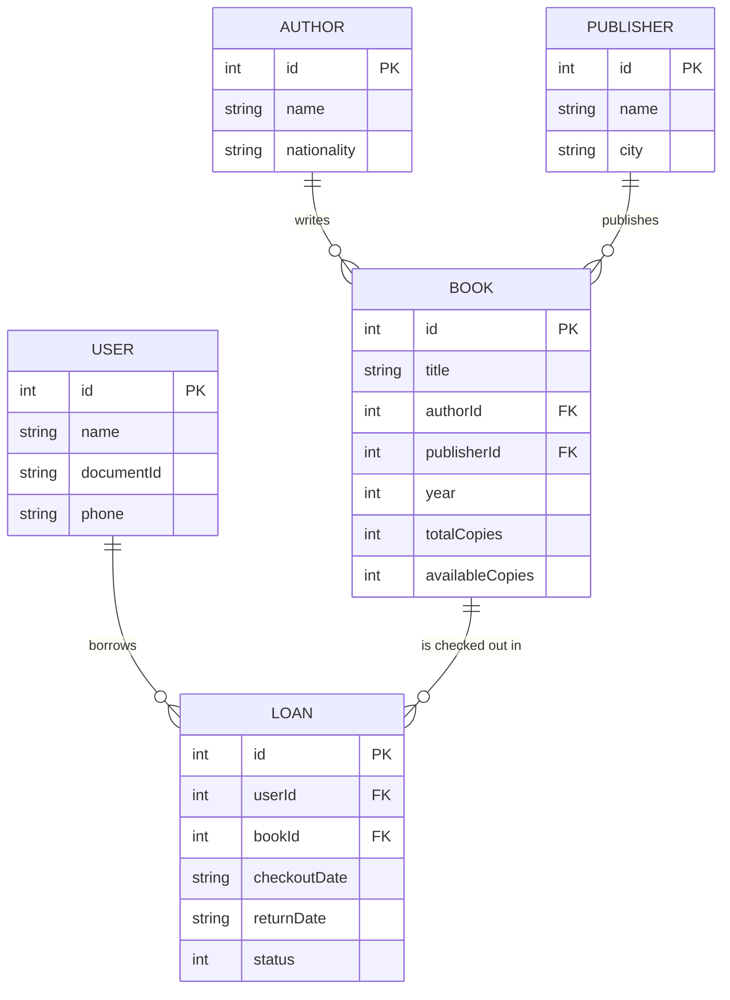

# 📚 Library Management System in C

🌍 **Language:** English | [Português](README.pt-br.md)


-lightgrey)


A relational, console-based **Library Management System** implemented in standard **C (C99)** without external dependencies. The application models a complete library domain with full **CRUD** operations for Books, Authors, Publishers, and Users, paired with an automated **Loan & Return transaction processing engine** and **binary file persistence**.

Originally conceived and developed as an academic project at **Universidade São Francisco (USF)** for the *Programming Tools & Techniques* discipline.

---

## 🎯 Domain & Architecture Overview

Small community and school libraries frequently track their inventory and circulation using loose spreadsheets or paper records. This software provides a lightweight, deterministic, and self-contained solution that runs on any workstation without requiring internet access or database servers.



---

## 🚀 Key Features

### 1. Relational Entity Management (CRUD)
- **Authors & Publishers:** Independent catalog entities managed with automated auto-incrementing IDs.
- **Books:** Relational child entity referencing valid Author and Publisher foreign keys.
- **Users:** Reader registry with contact and identification tracking.

### 2. Loan & Return Transaction Engine
- **Inventory Validation:** Prevents checkouts when `availableCopies == 0`.
- **Automatic Stock Updates:** Decrements available inventory on checkout and restores stock on return.
- **System Clock Timestamping:** Automatically registers checkout and return timestamps (`DD/MM/YYYY`) using `<time.h>`.
- **Status Machine:** Enforces valid lifecycle transitions (`STATUS_BORROWED (0)` $\rightarrow$ `STATUS_RETURNED (1)`).

### 3. Referential Integrity & Data Protection
- **No Orphan Records:** Blocks deletion of authors or publishers that still have registered books.
- **Active Loan Protection:** Prevents deletion of books or users associated with pending/active loans.

### 4. Robust Input Sanitization
- **Buffer Overflow Guard:** Text inputs use `fgets` with newline removal and stream flushing to eliminate buffer pollution.
- **Numeric Validation:** Uses `strtol` to strictly reject non-numeric characters and trailing garbage (e.g., rejecting `"12a"`).
- **Cross-Platform CLI:** Supports conditional compilation (`#ifdef _WIN32`) for native screen clearing across Windows, macOS, and Linux.

### 5. Binary File Persistence
- State is serialized into binary data files (`.dat`) on each change using `fwrite` and loaded at startup with `fread`.

---

## 📁 Repository Structure

```text
c-library-management-system/
│
├── src/
│   ├── main.c                 # Primary English source code
│   └── sistema_biblioteca.c   # Original Portuguese source code
│
├── docs/
│   └── academic-report-ptbr.pdf # Full academic specification report
│
├── Makefile                   # Build automation script for GCC
├── .gitignore                 # Excludes binaries, object files, and .dat stores
├── README.md                  # Main English documentation
└── README.pt-br.md            # Portuguese documentation
```

---

##  Compilation & Execution

### Prerequisites
- GCC, Clang, or any C99-compliant compiler.
- Make (optional, for automated build).

### Option 1: Compiling with `make` (Linux / macOS / MinGW)

```bash
# Build the executable
make

# Run the program
make run

# Clean build artifacts
make clean
```

### Option 2: Compiling directly with `gcc`

#### On Linux / macOS:
```bash
gcc -Wall -Wextra -std=c99 src/main.c -o library_system
./library_system
```

#### On Windows (Command Prompt / PowerShell):
```cmd
gcc -Wall -Wextra -std=c99 src\main.c -o library_system.exe
library_system.exe
```

---

##  Authors & Academic Context

Project developed at **Universidade São Francisco (USF)**.

- **Thiago A. Duarte**  
  - LinkedIn: [Thiago Duarte](https://www.linkedin.com/in/thiago-duarte-32a64839)  
  - GitHub: [Tduarte89](https://github.com/Tduarte89)

**Academic Project Collaborators:**  
Guilherme Henrique de Souza Ramos, Júlio Cesar Grilo dos Santos, Pablo Pericles de Assis Souza.
